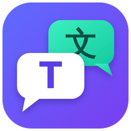

<p align="center">
  
</p>

<h1 align="center">Tolk</h1>

<p align="center">复制两次，就是翻译。Windows 和 macOS 通用的免费开源翻译工具。</p>

<p align="center">
  <a href="https://tolk.achord.cn">官网</a> ·
  <a href="#下载">下载</a> ·
  <a href="CHANGELOG.md">更新日志</a> ·
  <a href="https://github.com/Achordchan/tolk/issues">问题反馈</a>
</p>

Tolk 平时待在托盘或菜单栏里。在任何软件里选中文字、连按两次复制，译文就弹出来；也能框选屏幕截图翻译，或者在输入框里把写好的中文直接换成外语。

## 下载

| 系统 | 加速镜像（国内推荐） | GitHub 直连 |
|---|---|---|
| Windows 10 / 11（64 位） | [下载安装程序](https://tolk.achord.cn/download/win?via=mirror) | [下载安装程序](https://tolk.achord.cn/download/win?via=github) |
| macOS（Apple 芯片和 Intel 通用） | [下载 dmg](https://tolk.achord.cn/download/mac?via=mirror) | [下载 dmg](https://tolk.achord.cn/download/mac?via=github) |

链接总是指向最新版本。也可以到 [官网](https://tolk.achord.cn) 或 [Releases](https://github.com/Achordchan/tolk/releases) 页下载。装好以后，新版本会在后台自动下载，下载的文件都会校验签名。

## 功能

- **复制两次呼出翻译**：选中文字，按 Ctrl+C+C（macOS 是 ⌘+C+C，按住 ⌘ 连按两下 C），译文窗口直接出现。
- **截图翻译**：按 Ctrl+X+X（macOS 是 ⌘+X+X）框选屏幕任意区域，在本机识别文字，译文贴回图片原来的位置；可以对照原文、复制图片，或者钉在屏幕上。
- **输入助手**：在输入框里选中写好的文字，按 Alt+Shift+Space（⌥⇧Space），挑一个外语候选，直接替换回去。
- **Mini 模式**：译文以小气泡出现在鼠标旁边，不弹大窗口。
- **多种翻译服务**：微软、Google、DeepL、AI 翻译（任何 OpenAI 兼容接口）、Achord 内置引擎；macOS 还可以用系统自带的 Apple 离线翻译。支持 37 种语言。
- **主题**：跟随系统、浅色、深色、粉色；原文和译文字号可分别调整。

两个系统之间的细节差别见 [docs/platform-differences.md](docs/platform-differences.md)。

## 安装

**Windows**

1. 运行 `Tolk-setup-windows_<版本>.exe`。
2. 如果出现「Windows 已保护你的电脑」，点「更多信息 → 仍要运行」。
3. 装好后 Tolk 在右下角托盘：左键打开主窗口，右键是菜单。

截图翻译用的是 Windows 自带的文字识别，需要系统里装有对应语言的 OCR 语言包。

**macOS**

1. 打开 `Tolk-<版本>-macos.dmg`，把 Tolk 拖进「应用程序」。
2. 第一次打开如果提示无法验证开发者，到「系统设置 → 隐私与安全性」，在页面下方点「仍要打开」。
3. 按 Tolk 的引导打开「辅助功能」和「录屏」权限，输入助手、截图翻译和系统级 ⌘+C+C 监听要用到。

**从 2.2.2 及更早版本升级**：这些版本不能在软件里自动升级，需要手动下载安装一次，设置和 API Key 都会保留；macOS 要重新授予一次权限。之后的版本都能自动更新。

## 隐私

- 设置和 API Key 只保存在本机的 `~/.tolk/config.json`。
- 要翻译的文字只发给你选的翻译服务。截图在本机识别，图片本身不会上传。
- 出错时 Tolk 会自动上传错误报告（同一种错误一天最多一次），可以在「设置 → 关于」里关掉。在「关于」里点「提交问题」发给开发者的内容，发送前可以看到全部，API Key、邮箱和电脑用户名会先去掉。

## 反馈

遇到问题可以在软件里「设置 → 关于 → 提交问题」，不需要 GitHub 账号；也可以在 [Issues](https://github.com/Achordchan/tolk/issues) 提。

---

## 开发

Tolk 基于 [mygo](https://github.com/egoist/mygo)（Go + 系统 WebView）。macOS 上的截图翻译、系统级 ⌘+C+C 监听和权限引导由 `macos/helper` 里的 Swift 小助手提供。

### 目录

| 路径 | 内容 |
|---|---|
| `main.go` `service.go` `prefs.go` `settings.go` `app.go` `mini.go` | 主程序与前端可调用的服务 |
| `mac.go` `helper_darwin.go` `helper_stub.go` | macOS 小助手的接入（其他平台为空实现） |
| `ia_windows.go` `internal/winsel` | Windows 输入助手：读选区（UI 自动化 / 模拟复制）、粘贴替换、热键、不抢焦点的候选浮层 |
| `screenshot_windows.go` `screenshot_hotkey_windows.go` | Windows 截图翻译与 Ctrl+X+X 快捷键 |
| `internal/inputassist` | 输入助手的设置和与平台无关的逻辑（应用过滤、语言、候选列表、按键裁决、版面、缓存、翻译编排） |
| `internal/engine` | 翻译引擎与语言表 |
| `internal/legacy` | 配置读写（`~/.tolk`），引擎构建 |
| `internal/update` | 更新器：GitHub 直连与中转测速选线、Windows Ed25519 更新包、macOS Sparkle appcast |
| `internal/helper` `macos/helper` | 小助手的 Go 客户端、Swift 实现与协议（`PROTOCOL.md`） |
| `cmd/tolk-release` | 发布工具：打包、签名、appcast、latest.json |
| `src` `index.html` `mini.html` `panel.html` | 前端（`panel.html` 是 Windows 输入助手的候选面板） |
| `installer/setup.iss` | Windows 安装器 |
| `site` | 官网 tolk.achord.cn（Cloudflare Worker），见 [site/README.md](site/README.md) |

### 构建

```sh
bun install
bun run dev          # 热更新
go test ./...
bun run build        # 当前平台
```

macOS 上要带上小助手：

```sh
(cd macos/helper && swift build -c release --arch arm64 --arch x86_64)
mkdir -p resources/darwin-universal
cp "$(cd macos/helper && swift build -c release --arch arm64 --arch x86_64 --show-bin-path)/tolk-helper" resources/darwin-universal/
bun run build -- -platform darwin/universal
```

开发时也可以用环境变量 `TOLK_HELPER=/path/to/tolk-helper` 指定小助手。

发布流程见 [docs/RELEASING.md](docs/RELEASING.md)。

## 许可证

本项目以 [GNU GPL v3](LICENSE) 发布。内置的 DeepLX 部分沿用其 MIT 许可证，见 [third_party/DeepLX-LICENSE](third_party/DeepLX-LICENSE)。
